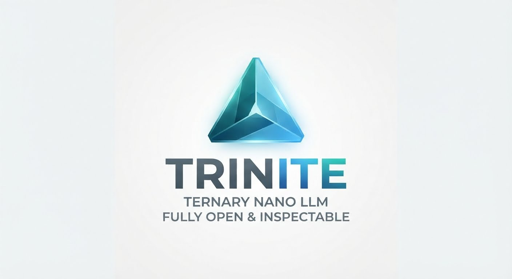

<p align="center">
  
</p>

<p align="center">
  <a href="https://github.com/QSOLKCB/Trinite/actions/workflows/cpu.yml"></a>
  <a href="https://github.com/QSOLKCB/Trinite/actions/workflows/reference-conformance.yml"></a>
  <a href="https://github.com/QSOLKCB/Trinite/actions/workflows/etq-donor.yml"></a>
  <a href="LICENSE"></a>
</p>

<p align="center">
  <strong>Inspectable, CPU-first neural research.</strong><br>
  Small dense, ternary and four-state decoders · exact synthetic curricula · reproducible training and evidence · measured geometry
</p>

Trinite is an open research workbench for asking what small, fully inspectable models **actually learn**. It keeps native numerical computation, admitted data, frozen protocols, checkpoint replay and [PROVENANCE](docs/PROVENANCE.md) evidence separate from claims about reasoning or deployment.

## Research status

**Phases 0–4 are implemented.** The source, test harnesses and bounded research experiments are usable; this is **not a trained general-purpose assistant or a production-ready model**. Phases 5–9 remain conditional on learning, replication, intervention and deployment evidence.

| Area | Implemented | What remains unresolved |
| --- | --- | --- |
| **Native CPU models** | Matched dense, ternary and classical four-state reference lanes; deterministic training, safe tensors and restart/replay | Reliable held-out performance, weight-format selection and packed inference |
| **Exact learning tasks** | Admitted arithmetic, finite maths, folds, lattice traversal and QEC-related synthetic probes; frozen comparison protocols | Per-task learning adequacy, composed-output generalization and arithmetic retention together |
| **Geometry observation** | Detached activations, pinned analysis, [E8/ETQ finite mapping](docs/E8-REFERENCE.md), [recursive 3×3×3 scaffold](docs/LATTICE-SCAFFOLD.md), [matched lattice controls](docs/ACTIVATION-LATTICE.md), [post-v0.1.0 MaleCNS/ETQ-303 comparison](docs/CNR-001.md) | A demonstrated neural geometry mechanism or beneficial intervention |
| **Verification** | Hash-bound sources and requests, strict input auditing, [PROVENANCE](docs/PROVENANCE.md) custody, independent checks and complete optimizer replay in the newer retention workflow | Independent-host replication and final release-readiness assessment |

### The results matter, including the failures

The first 27-cell dense/ternary/four-state comparison recorded **0% held-out complete-answer accuracy** in every lane. Longer training passed some *exposed-training* criteria but failed important held-out tasks. Balanced arithmetic rehearsal restored training retention while maths performance traded off; an 8,192-update budget improved aggregate maths counts without any of the twelve maths tasks reaching its 90% gate. The later task-balanced experiment has a **reported negative matrix** in PR #29, but its complete original archive and independently retained commitments have not been located for verification. [Archival closure remains unresolved](docs/MATHS-TASK-BALANCE.md#reported-matrix-and-unresolved-archival-closure).

The later [seed-0 native diagnostic](docs/UNSEEN-NEGATIVE-RESULT.md) fit all 264 training rows but scored **0/64 validation and 0/64 test complete answers**. The exact public row subset and [coverage diagnostic](docs/COVERAGE-DIAGNOSTIC.md) preserve this historical, exploratory generalisation failure; it is not a fresh confirmation study.

The [position-coupling study](docs/POSITION-STUDY-RESULT.md) retained perfect training fit in all six cells, but did not meet its frozen transfer criteria: unseen whole-family gains varied by seed and both longer-number strata failed. The mixed/negative development result is preserved without changing the protocol.

A separate [CPU positional-exposure ablation](docs/POSITION-EXPOSURE-V1.md) now
implements matched fixed/balanced-offset controls. Its target run is unperformed;
coarse address/role coverage does not supply unseen arithmetic significances.

The [four-cell procedural-QEC v3 study](docs/PROCEDURAL-QEC-V3-NEGATIVE-RESULT.md) also failed its training gate; complete replay and archival checks passed, while historical control ordering was not preserved.

Phase 4's initial item-versus-carrier geometry contrasts were negative. The E8/ETQ parity checks prove exact finite-payload agreement, and the activation-to-lattice experiment is **retrospective and training-exposed**—neither demonstrates learned geometric reasoning. **Geometry loss remains zero.** See the [roadmap](docs/ROADMAP.md), [Phase 4 limitations](docs/PHASE-4.md) and [initial milestone notes](docs/RELEASE-NOTES-v0.1.0.md) for the complete status.

## Get started

Foundation, protocol and evidence checks use the Python standard library (3.11+). Model and training tests require the separately [hash-locked CPU environment](docs/GETTING_STARTED.md); no model weights are downloaded implicitly.

```sh
PYTHONPATH=src python -m unittest discover -s tests -v
# After installing the pinned CPU requirements:
PYTHONPATH=src python scripts/check_research_cpu.py
```

Start with the [getting-started guide](docs/GETTING_STARTED.md), [documentation index](docs/README.md) and [architecture](docs/ARCHITECTURE.md). Implementing agents should read [AGENTS.md](AGENTS.md), [invariants](docs/INVARIANTS.md) and [operating instructions](docs/INSTRUCTIONS.md). The original [idea](docs/IDEA.md) is preserved.

## Milestone and rights

The immutable **v0.1.0** tag is an *initial research/source checkpoint* covering **25 merged PRs numbered #1–#26 (excluding the unmerged revert PR #11)**, **not** a Phase 9 deployment certification, PyPI package version, released model-weights bundle or successful learning claim. The package metadata remains separately versioned until a deliberate packaging release. Keep immutable tags tied to the final reviewed commit; do not move historical evidence or tags.

Repository code: [MPL-2.0](LICENSE). Admitted data, imported upstream references, external assets and future weights each retain their own rights and provenance requirements.
